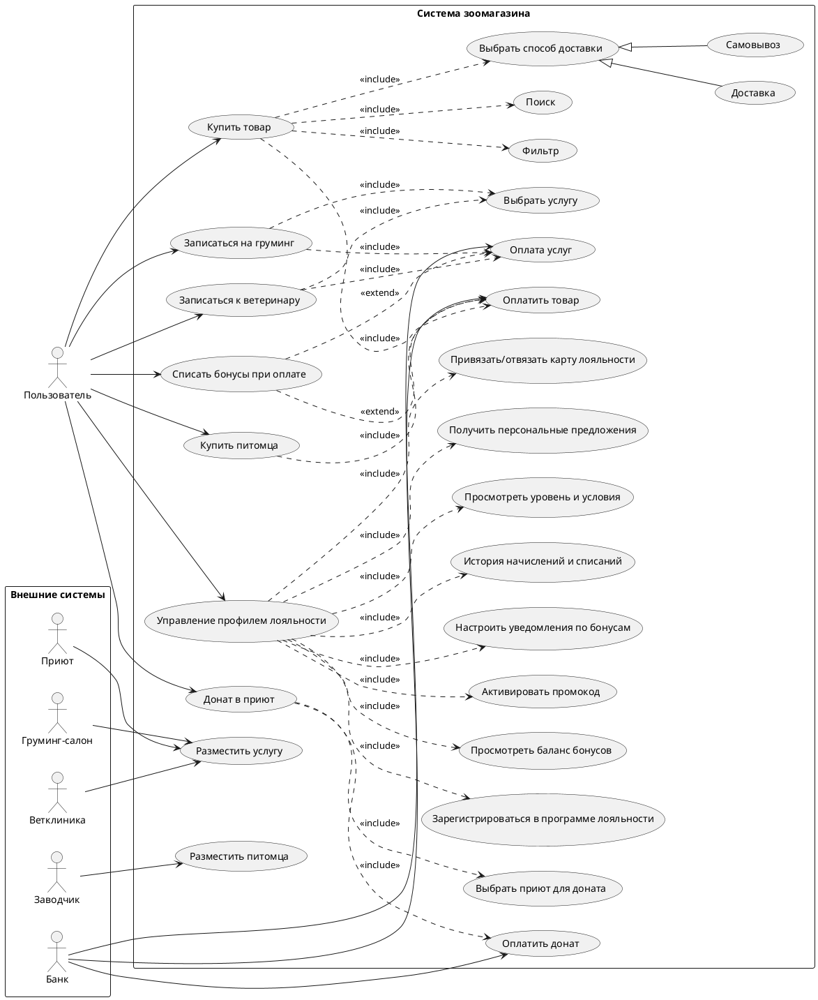

#  Зоология — Интернет-магазин зоотоваров

##  О проекте

**Зоология** — сеть из 20+ магазинов зоотоваров на Дальнем Востоке, выходящая на федеральный уровень. Проект представляет собой разработку масштабируемой e-commerce платформы с расширенным функционалом для продажи зоотоваров, услуг и интеграции с партнёрами.

### Ключевые параметры

| Параметр | Значение |
|----------|----------|
| **Заказчик** | Сеть магазинов «Зоология» (20+ точек) |
| **Регион старта** | Дальний Восток → вся Россия |
| **Инвестор** | Мария Собачкина |
| **Бюджет (2 года)** | 15–20 млн ₽ |
| **Текущая клиентская база** | 1 500 человек (Excel, идентификация по телефону) |
| **Опыт в e-commerce** | 0,5 года (соцсети и мессенджеры) |

---

##  Цели проекта

1. Запуск полноценного интернет-магазина для продажи зоотоваров.
2. Масштабирование на всю Россию в течение 2 лет.
3. Автоматизация работы с клиентской базой и программами лояльности.
4. Интеграция с существующей инфраструктурой (1С, курьерские службы).
5. Создание экосистемы услуг для владельцев животных.

---

##  Функциональные требования

### Основной функционал

-  **Продажа кормов** для животных.
-  **Сопутствующие товары** (поводки, ошейники, игрушки и т.д.).
-  **Донаты для приютов** — ежемесячные отчисления в выбранный приют.
-  **Продажа породистых животных** (кошки, собаки).
-  **Запись в ветеринарные клиники** (партнёрские).
-  **Услуги для животных** (стрижка, передержка, выгул).
-  **Интеграция с курьерскими службами** (самовывоз, доставка со склада).
-  **Система уведомлений** (email, SMS, push).
-  **Программа лояльности** (скидки, бонусы, уровни).
-  **Онлайн-оплата**.
-  **Рекомендательная система** — формирование персональных подборок на основе поведения пользователя (покупки, лайки).

### Интеграции

- **1С** — синхронизация товаров и платежей.
- **Курьерские службы** — расчёт доставки, трекинг.
- **Платёжные системы** — онлайн-оплата.

---

##  Дорожная карта (2 года)

| Период | Этап |
|--------|------|
| **0–3 мес.** | Запуск продажи товаров (MVP) |
| **3–6 мес.** | Донаты в приюты, продажа щенков/котят |
| **6–12 мес.** | Запись в партнёрские ветклиники |
| **12–18 мес.** | Услуги для животных (стрижка, передержка, выгул) |
| **18–24 мес.** | Выход на центральную Россию |

---

##  Технические требования

### Платформа

- **Старт:** веб-сайт (дешевле и проще).
- **Перспектива:** мобильное приложение (после запуска сайта).
- **Хостинг:** облачная инфраструктура (собственных мощностей нет).
- **Масштабирование:** горизонтальное, несколько инстансов для распределения нагрузки.

### Архитектурные принципы

-  **Масштабируемость** — рост по мере увеличения клиентской базы.
-  **Надёжность** — отказоустойчивость, резервирование.
-  **Облачная инфраструктура** — без собственных серверов.
-  **Несколько инстансов** — распределение нагрузки.

---

##  Бюджет и ресурсы

- **Бюджет:** 15–20 млн ₽ на 2 года.
- **Инвестор:** Мария Собачкина.
- **Команда:** будет сформирована (требуется уточнение).

---

##  Текущее состояние

-  Существующая сеть магазинов (20+ точек).
-  Настроенная 1С (товары, платежи).
-  Клиентская база 1 500 человек (Excel).
-  Опыт онлайн-продаж: 0,5 года (соцсети, мессенджеры).
-  Интернет-магазин: не запущен.
-  Мобильное приложение: в перспективе.

---

##  Диаграмма (PlantUML)




---


````
